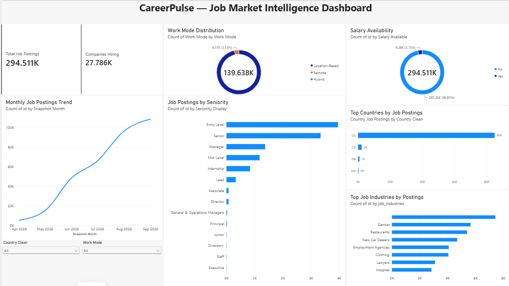
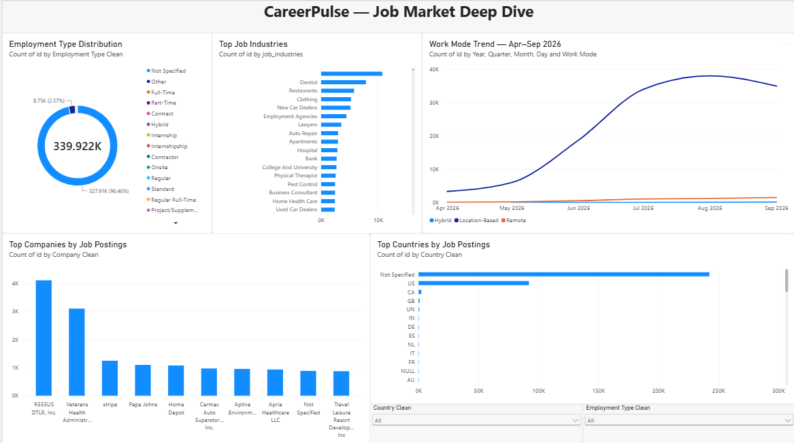
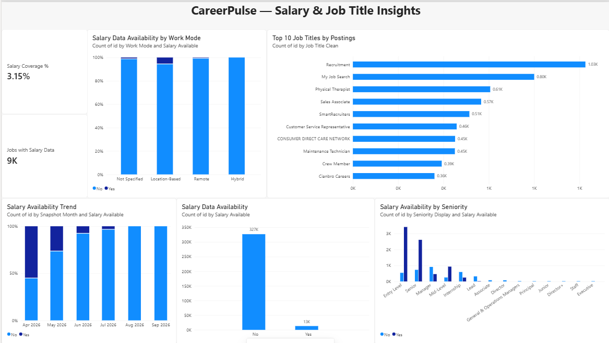

# CareerPulse — Job Market Intelligence Dashboard

CareerPulse is a Power BI dashboard project that analyzes job-market data to identify hiring trends, work-mode patterns, employment types, salary availability, job titles, companies, industries, and countries.

## 📊 Dashboard Preview

### 1. Job Market Intelligence Dashboard


### 2. Job Market Deep Dive


### 3. Salary & Job Title Insights


## 🔍 Key Insights Explored

- Monthly job posting trends
- Work mode distribution
- Hiring by seniority level
- Top countries by job postings
- Top job industries
- Top companies by job postings
- Employment type distribution
- Salary data availability
- Top job titles

## 🛠️ Tools & Technologies

- Power BI
- Power Query
- DAX
- Data Cleaning & Transformation
- Data Visualization
- Business Analytics

## 📁 Project Structure

```text
CareerPulse/
│
├── Dashboard/
│   ├── dashboard-overview.png
│   ├── dashboard-deep-dive.png
│   └── salary-job-title-insights.png
│
├── Data/
│   └── Dataset information
│
├── Documentation/
│
└── README.md